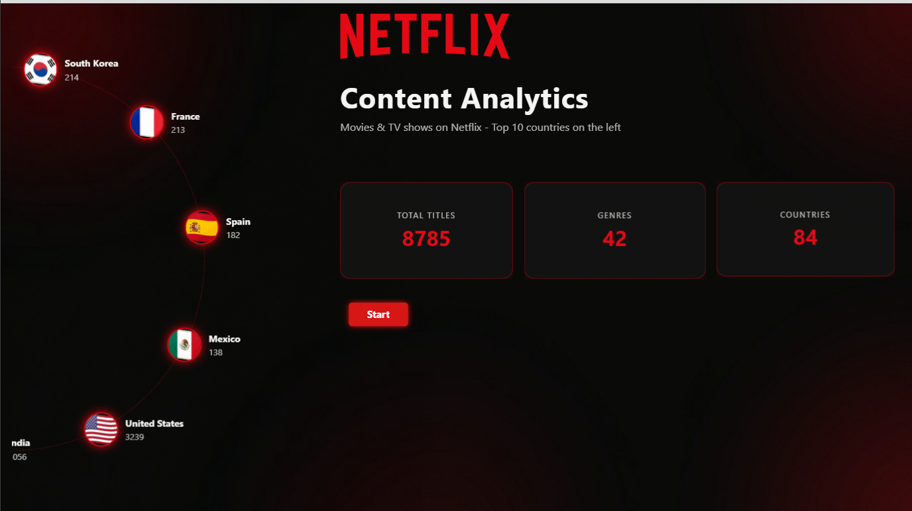
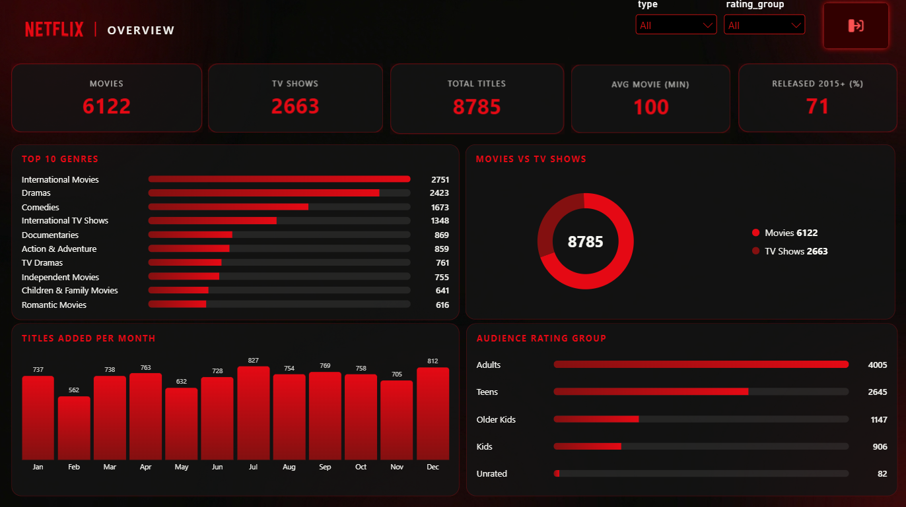
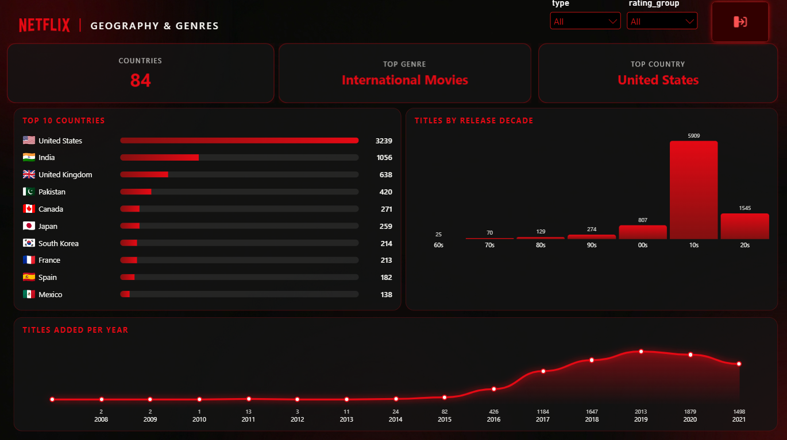
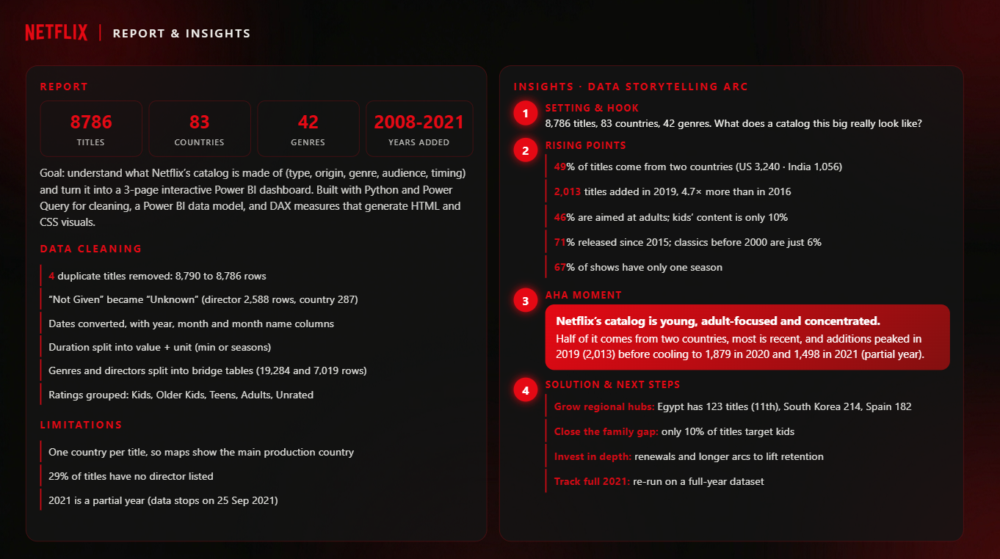

# 🎬 Netflix Content Analytics | Power BI

An interactive **3-page Power BI dashboard** that analyzes what the Netflix catalog is made of: content type, country of origin, genre, audience rating and timing of additions.

---

## 📌 Project Overview

The project turns a raw Netflix titles dataset (**8,786 titles after cleaning, 42 genres, additions from 2008 to 2021**) into a clear story about the catalog.

The analysis focuses on:

- 🎞️ Movies vs TV Shows
- 🌍 Production countries
- 🎭 Genres
- 👥 Audience rating groups
- 📅 Titles added per month and per year
- 🗓️ Release decades

---

## 🛠️ Tools & Technologies

- **Microsoft Power BI**
- **Power Query**
- **Python** (data cleaning)
- **DAX** (measures generating HTML/CSS visuals)
- **Data Modeling** (Netflix_Clean, Netflix_Genres, Flags)
- **Data Visualization** (dark and light themes)

---

## 🧹 Data Cleaning

| Step | What was done | Result |
|---|---|---|
| Duplicates | 4 repeated titles with different IDs removed | 8,790 → 8,786 rows |
| Hidden characters | Non-breaking spaces trimmed from titles | Clean text keys |
| Placeholders | "Not Given" in director (2,588 rows) and country (287) set to "Unknown" | No blanks or nulls |
| Dates | `date_added` text converted to Date, plus year, month, month name | Time analysis ready |
| Duration | "90 min" / "2 Seasons" split into value + unit | One numeric column |
| Multi-value fields | Genres and directors split into bridge tables | 19,284 and 7,019 rows |
| Ratings | 14 rating codes grouped: Kids, Older Kids, Teens, Adults, Unrated | Audience view |
| Map names | Soviet Union and West Germany mapped to Russia and Germany | Map-safe countries |

---

## 📊 Dashboard Structure

```text
Netflix Content Analytics
│
├── 1. Landing
│   ├── Top 10 countries as rotating flags
│   └── Flip KPIs (Total Titles, Genres, Countries)
├── 2. Overview
│   ├── 5 KPIs
│   ├── Top 10 Genres
│   ├── Movies vs TV Shows
│   ├── Titles Added per Month
│   └── Audience Rating Group
├── 3. Geography & Genres
│   ├── Top 10 Countries with flags
│   ├── Titles by Release Decade
│   └── Titles Added per Year
└── Report & Insights page
```

---

## 🖼️ Dashboard Preview

### 🏠 Landing


### 📈 Overview


### 🌍 Geography & Genres


### 📝 Report & Insights


---

## 💡 Key Insights

Organized along the **Data Storytelling Arc**:

1. **Setting:** 8,786 titles, 42 genres, 83 known countries.
2. **Rising points:**
   - 49% of titles come from two countries: United States (3,240) and India (1,056).
   - 2,013 titles were added in 2019, 4.7x more than in 2016.
   - 46% of titles are aimed at adults; kids' content is only 10%.
   - 71% of titles were released since 2015.
   - 67% of shows have only one season.
3. **Aha moment:** Netflix's catalog is young, adult-focused and concentrated. Additions peaked in 2019 (2,013) before cooling to 1,879 in 2020 and 1,498 in 2021 (a partial year).
4. **Next steps:**
   - Grow regional hubs (Egypt has 123 titles, South Korea 214, Spain 182).
   - Close the family gap with more kids' and family content.
   - Invest in depth: renewals and longer arcs for one-season shows.
   - Re-run the dashboard on a full-year 2021 dataset.

---

## ⚠️ Limitations

- Each title has one country only, so maps show the main production country.
- 29% of titles have no director listed.
- 2021 is a partial year: the data stops on 25 September 2021.
- 14 titles show an added date earlier than their release year; they are flagged, not removed.
- **Known count difference:** the cleaned data and the Report page show **8,786 titles** and **83 countries** (not counting "Unknown"). The dashboard KPI cards show 8,785 titles and 84 countries: the 84 includes the "Unknown" country value, and the one-title gap (6,122 vs 6,123 movies, 1,147 vs 1,148 Older Kids) comes from one movie that the dashboard does not count. The cause is not yet identified.

---

## 📁 Repository Contents

| File | Description |
|---|---|
| `Netflixe2.pbix` | Power BI dashboard |
| `Netflix_Clean.csv` | Cleaned titles table |
| `Netflix_Genres.csv` | Genre bridge table |
| `Netflix_Directors.csv` | Director bridge table |
| `Flags.csv` | Country flags lookup |
| `Netflix_Report_Insights.html` | Standalone report and insights page |
| `screenshots/` | Dashboard images |

---

## 🎓 Skills Demonstrated

- Data cleaning and transformation with Python and Power Query
- Data modeling with bridge tables
- DAX measures and KPI design
- Interactive dashboard design with navigation and slicers
- Data storytelling and business recommendations

---

## 👨‍💻 Author

**Mohamed Salem**

Data Analyst | Power BI | SQL | Excel

This project is part of my practical **Data Analytics** work, focused on data preparation, analysis, visualization, and business intelligence.

---

⭐ **If you find this project useful, feel free to star the repository.**
